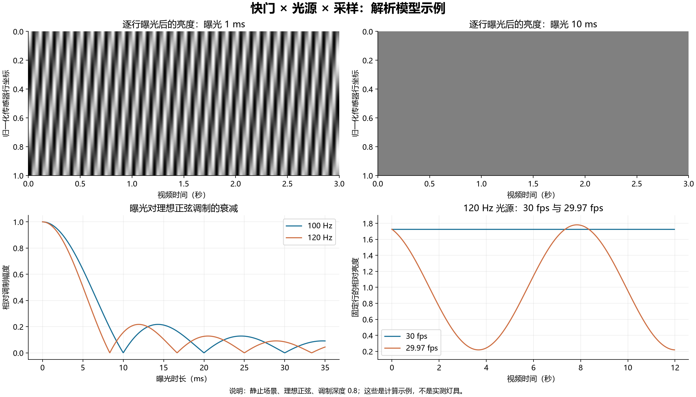
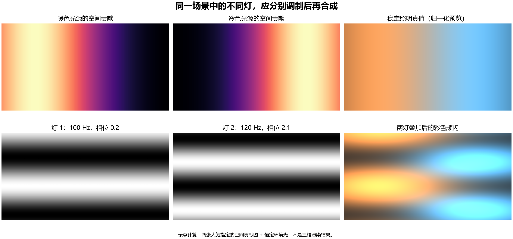

---
{
  "title": "首轮报告快照",
  "updated": "2026-09-16",
  "archived": true,
  "search": false
}
---

# 真实频闪数据集背景调研

日期：2026-09-16。项目：camera_research。

**结论：Kubric 适合做场景、运动、资产与标签的组织底座；满足真实频闪数据需求，必须增加灯具时间响应、逐行曝光积分和相机处理层。严格研究灯光光谱与材质显色差异时，还需要光谱光传输。**

本轮只调查数据集与生成过程，不设计或训练网络。完成了文献检索、关键全文/采集图核对、公开入口检查、Kubric 固定提交的静态审计，以及两个成像计算示意图。没有运行 Kubric 渲染，也没有验收整套第三方数据文件。

## 报告导航

| 报告 | 包含内容 |
|---|---|
| [01 论文与数据资源](01_literature_and_datasets.md) | 14 个重点条目、传统/硬件/测量工作、公开状态、真值来源、规模口径及上游波形/光谱/材质资源 |
| [02 物理模型与覆盖设计](02_physical_model_and_coverage.md) | 光学光谱和时间频谱的区别；快门、驱动、颜色、灯数、材质与反射；参数范围、场景组合、GT、拆分与验证 |
| [03 Kubric pipeline 审计](03_kubric_pipeline_audit.md) | 原生能力矩阵；10 个默认生成阶段；函数调用和结果示例；源码行号；缺失模块、版本与性能边界 |
| [04 索尼官方专题](04_sony_official_findings.md) | 官方对偏色/条带、焦平面快门、防闪择时、可变快门、LED 漏采/饱和的说明，以及对应的数据生成条件 |

## 1. 三类资源最值得优先看

- **BurstDeflicker：**当前直接面向动态场景频闪恢复的数据参考。需要留意静态短长曝光与绿幕动态合成的真值边界。[论文与代码入口](https://github.com/qulishen/BurstDeflicker)
- **ISET-LFM：**光谱场景、独立光源组、相机/传感器模拟的生成参考；现成数据主要针对汽车场景。[生成框架](https://github.com/AyushJam/iset-lfm)
- **DELIGHT：**灯具实测时间响应，包含不同技术和部分分色测量；适合建立灯具波形库的起点。[作者资料](https://www.dgp.toronto.edu/ACam/)

RIFLE、MIRAGE/CLEAR、DeViD/VDFP、Bricker/BRACE 主要研究屏幕重拍。它们的扫描驱动、分区调光、子像素和摩尔纹值得独立建模，但不能等同于普通灯光照射人物。

## 2. 与上轮初步设计相比，需要补充的认识

1. **不能仅按“LED/荧光灯”选择一个固定正弦。** 型号、驱动、档位、颜色通道和同步组都会改变时间响应。
2. **不同 SPD 不必然意味着不同时间波形。** 真正影响彩色频闪的是波长—时间发射、材质响应与相机响应共同作用。
3. **快门速度、读出时间、帧率是不同变量。** 120 Hz 与 29.97 fps 的理想拍频周期约为 8.34 秒，短片段可能看不全。
4. **干净 GT 应保留灯的平均贡献和原来运动。** 将灯关闭、取时间均值、换更长曝光，都可能改变任务。
5. **论文中有数据集，不代表当前公开包可用。** RIFLE/VDFP 下载区为 TBD，Bricker 为 TODO，CLEAR 项目页标为 Coming Soon；详细核验口径见报告 01。
6. **Kubric 的默认彩色帧与 motion_blur 不等于线性曝光模拟。** 需要接通 EXR 浮点输出并实现独立时间积分。
7. **物理步频高，不等于导出轨迹稠密。** 默认 PyBullet wrapper 按视频帧保存状态，必须检查曝光内动态。

这些判断的出处、适用条件和例子均在分报告中给出。本文不是对全网资料的穷尽保证；未取得全文或数据的项目明确标注，参数建议不冒充厂商规格。

## 3. 推荐的生成架构

```text
真实场景与材质 + 灯具/驱动/光谱库
                    ↓
           Kubric 场景和运动组织
                    ↓
     线性 RGB 或光谱的独立光源贡献
                    ↓
          自定义逐行曝光积分
          ├─ 原始调制 → 频闪输入
          └─ 平均发光 → 稳定照明 GT
                    ↓
         相机响应、噪声和 ISP 变体
                    ↓
       标签、元数据、分层检查与导出
```

建议主数据采用**RGB 多光源 + 严格时间积分**；另设**规模较小、经过标定的光谱验证子集**。如果研究目标本身要求真实 SPD/反射谱/QE 的比较，光谱子集是必要组成，不能用 RGB 颜色近似替代。

## 4. 两张解释性图

下面是公式计算示例，不是实测灯具或 Kubric 渲染结果。





## 5. 核查记录与边界

- Kubric 提交固定为 `61f2422c84bab75006df33c6989e0b483db3ccfe`；源码链接均固定到该版本。
- 检查了 Scene/Asset/View、相机、灯光、材质、模拟器、Blender 渲染/EXR、writer、MOVi worker 和 Docker 配置。
- 关键论文图表做了视觉检查；生成图做了数值和显示检查。
- 网页直接下载失败但搜索工具可读取的资料，仍按实际读取渠道使用；没有将直接下载成功与“数据集已下载完整”混为一谈。
- [引用入口清单](source_inventory.json) 记录报告中的去重链接；[下载核验记录](retrieval_log.json) 记录本轮本地资料获取状态。原始证据与源码快照保存在工作区 `.research`，不作为已经生成的数据集交付。

目前最合适的后续工作是把本报告的需求变成可验证的生成器规格，再实现少量标定场景。此处没有提前启动实现或训练。
